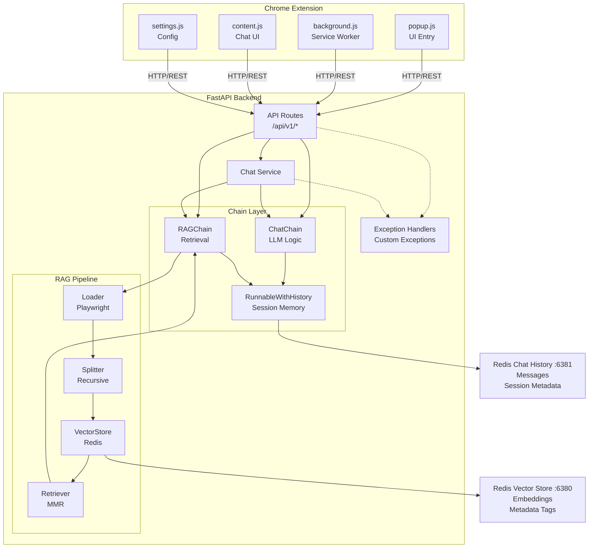

# 🤖 AI Chat Assistant - Chrome Extension with RAG Backend

A production-ready AI-powered chatbot Chrome extension featuring **Retrieval-Augmented Generation (RAG)**, **session management**, and **intelligent context-aware responses**. Built with FastAPI, LangChain, Redis Vector Store, and Google Gemini LLM.


---

## 📋 Table of Contents

- [Overview](#-overview)
- [Features](#-features)
- [Architecture](#-architecture)
- [Tech Stack](#-tech-stack)
- [Project Structure](#-project-structure)
- [Installation](#-installation)
- [Configuration](#-configuration)
- [Usage](#-usage)
- [API Reference](#-api-reference)
- [Chrome Extension](#-chrome-extension)
- [Development](#-development)
- [Troubleshooting](#-troubleshooting)

---

## 🎯 Overview

AI Chat Assistant is an enterprise-grade Chrome extension that enables intelligent, context-aware conversations based on the content of any webpage. When a user starts a chat on a webpage, the system:

1. **Scrapes** the webpage content using Playwright
2. **Chunks** the content into semantically meaningful segments
3. **Embeds** the chunks using Google Generative AI embeddings
4. **Stores** the vectors in Redis Vector Store with session-based filtering
5. **Retrieves** relevant context for each user query using MMR (Maximal Marginal Relevance)
6. **Generates** intelligent responses using Google Gemini LLM with conversation history

---

## ✨ Features

### Core Functionality
- **🔍 RAG Pipeline**: Full Retrieval-Augmented Generation with semantic search
- **💬 Session Management**: Per-tab session isolation with Redis-backed chat history
- **🧠 Context-Aware Responses**: LLM responses grounded in webpage content
- **📝 Markdown & LaTeX Rendering**: Rich text formatting with mathematical notation support
- **⚙️ Custom LLM Settings**: Users can configure their own API keys and model preferences

### Technical Features
- **🔄 Singleton VectorStore Manager**: Enterprise-grade connection pooling
- **🎯 Session-Scoped Retrieval**: Filter vectors by session_id and user_id using Redis Tag filters
- **📊 MMR Search**: Maximal Marginal Relevance for diverse, relevant context retrieval
- **🔐 TTL-Based Session Expiry**: Automatic cleanup of stale sessions (24-hour default)
- **⚡ Async Web Scraping**: Non-blocking content extraction with Playwright
- **🐳 Docker Support**: Containerized Redis instances for development

### Chrome Extension
- **🎨 Floating Chat Widget**: Non-intrusive UI that works on any webpage
- **🔗 Per-Tab Sessions**: Each browser tab maintains its own chat context
- **💾 Persistent Settings**: User preferences stored locally
- **🎛️ Settings Page**: Configure custom LLM API keys, model selection, temperature

---

## 🏗️ Architecture



---

## 🛠️ Tech Stack

### Backend
| Technology | Purpose |
|------------|---------|
| **FastAPI** | High-performance async web framework |
| **LangChain** | LLM orchestration and chain composition |
| **LangChain-Google-GenAI** | Google Gemini LLM integration |
| **LangChain-Redis** | Redis Vector Store with semantic search |
| **Playwright** | Async web scraping and content extraction |
| **Redis Stack** | Vector database and chat history storage |
| **Pydantic** | Data validation and settings management |
| **Uvicorn** | ASGI server with hot-reload |

### Frontend (Chrome Extension)
| Technology | Purpose |
|------------|---------|
| **Manifest V3** | Modern Chrome extension architecture |
| **Service Worker** | Background script for session management |
| **Content Script** | Injected chat UI on webpages |
| **Marked.js** | Markdown parsing |
| **KaTeX** | LaTeX mathematical notation rendering |
| **DOMPurify** | XSS protection for rendered content |

---

## 📁 Project Structure

```
chrome-extension/
├── app/
│   ├── api/
│   │   ├── v1/
│   │   │   └── routes.py          # API endpoints (session, chat, history)
│   │   └── utils/
│   │       └── ids.py             # Session/User ID generators
│   │
│   ├── chains/
│   │   ├── chat_chain.py          # LLM chain with message history
│   │   └── rag_chain.py           # RAG orchestration (load → split → store → retrieve)
│   │
│   ├── core/
│   │   └── setting.py             # Pydantic settings from .env
│   │
│   ├── database/
│   │   └── redis_server.py        # RedisChatMessageHistory implementation
│   │
│   ├── exceptions/
│   │   ├── base.py                # Base exception with logging
│   │   ├── client_error.py        # 4xx errors (NetworkError, ModelNotFoundError)
│   │   ├── server_error.py        # 5xx errors (VectorStoreError, RetrieverError)
│   │   └── database_error.py      # Redis-specific errors
│   │
│   ├── prompts/
│   │   ├── system_prompt.py       # Prompt template builder
│   │   └── prompt.yaml            # Nova AI system prompt configuration
│   │
│   ├── rag/
│   │   ├── loader.py              # PlaywrightURLLoader wrapper
│   │   ├── splitter.py            # RecursiveCharacterTextSplitter
│   │   ├── vector_store.py        # Document storage with session metadata
│   │   ├── retriever.py           # Query-based document retrieval
│   │   └── vectorstore_manager.py # Singleton vectorstore connection manager
│   │
│   ├── services/
│   │   └── chat_service.py        # High-level chat operations
│   │
│   ├── ui/                        # Chrome Extension files
│   │   ├── manifest.json          # Extension manifest (V3)
│   │   ├── background.js          # Service worker (session lifecycle)
│   │   ├── content.js             # Chat widget injection
│   │   ├── popup.html/js          # Extension popup UI
│   │   ├── settings.html/js       # Custom LLM configuration page
│   │   ├── markdown-renderer.js   # Safe markdown + LaTeX rendering
│   │   ├── styles.css             # Chat widget styles
│   │   └── lib/                   # Third-party libs (marked, katex, purify)
│   │
│   ├── test/                      # Unit tests
│   └── main.py                    # FastAPI app entry point
│
├── docker-compose.yml             # Redis Stack containers
├── Dockerfile                     # FastAPI container (optional)
├── requirements.txt               # Python dependencies
├── .env                           # Environment configuration
└── README.md                      # This file
```

---

## 🚀 Installation

### Prerequisites

- **Python 3.11+**
- **Docker & Docker Compose** (for Redis)
- **Google Cloud API Key** (for Gemini LLM and embeddings)
- **Chrome Browser** (for extension)

### Step 1: Clone and Setup Backend

```bash
# Clone the repository
git clone <repository-url>
cd chrome-extension

# Create virtual environment
python -m venv venv

# Activate virtual environment
# Windows
venv\Scripts\activate
# Linux/Mac
source venv/bin/activate

# Install dependencies
pip install -r requirements.txt

# Install Playwright browsers (for web scraping)
playwright install chromium
```

### Step 2: Start Redis Services

```bash
# Start Redis Vector Store (port 6380) and Redis Chat History (port 6381)
docker-compose up -d

# Verify containers are running
docker ps
```

### Step 3: Configure Environment

Create or edit `.env` file in the project root:

```env
# LLM Configuration
EMBEDDING_MODEL=gemini-embedding-001
API_KEY=your_google_api_key_here
PRIMARY_MODEL=gemini-2.5-flash-lite
SECONDARY_MODEL=gemini-2.0-flash
MAX_TOKENS=128000
TEMPERATURE=1.0

# Redis Configuration
REDIS_VECTOR_URL=redis://localhost:6380
REDIS_DB_URL=redis://localhost:6381
```

### Step 4: Start the Backend Server

```bash
# Development mode with auto-reload
uvicorn app.main:app --reload --port 8000

# Or with debug logging
$env:APP_LOG_LEVEL="DEBUG"; $env:APP_ENV="local"; uvicorn app.main:app --reload --port 8000
```

### Step 5: Install Chrome Extension

1. Open Chrome and navigate to `chrome://extensions/`
2. Enable **Developer mode** (toggle in top-right)
3. Click **Load unpacked**
4. Select the `app/ui/` folder
5. The extension icon should appear in your toolbar

---

## ⚙️ Configuration

### Environment Variables

| Variable | Description | Default |
|----------|-------------|---------|
| `EMBEDDING_MODEL` | Google embedding model name | `gemini-embedding-001` |
| `API_KEY` | Google Cloud API key | Required |
| `PRIMARY_MODEL` | Primary Gemini model | `gemini-2.5-flash-lite` |
| `SECONDARY_MODEL` | Fallback Gemini model | `gemini-2.0-flash` |
| `MAX_TOKENS` | Maximum output tokens | `128000` |
| `TEMPERATURE` | LLM creativity (0.0-2.0) | `1.0` |
| `REDIS_VECTOR_URL` | Redis Vector Store URL | `redis://localhost:6380` |
| `REDIS_DB_URL` | Redis Chat History URL | `redis://localhost:6381` |
| `APP_LOG_LEVEL` | Logging level | `ERROR` |
| `APP_ENV` | Environment (`local`, `dev`, `prod`) | - |

### Custom LLM Settings (Chrome Extension)

Users can configure their own LLM settings through the extension:

1. Right-click the extension icon → **Options**
2. Enable **Use Custom LLM**
3. Enter your API key, select model, adjust temperature
4. Click **Test Connection** to verify
5. Save settings

---

## 📖 Usage

### Starting a Chat Session

1. Navigate to any webpage you want to ask questions about
2. Click the **AI Chat Assistant** extension icon
3. Click **Start Chat** - this will:
   - Scrape the webpage content
   - Process and embed the content
   - Create a new chat session
4. Type your question in the chat widget
5. Receive context-aware responses based on the page content

### Chat Features

- **Session Persistence**: Chat history is maintained per tab
- **URL Change Detection**: New session created when you navigate to a different page
- **Clear History**: Click the trash icon to clear current session
- **Minimize**: Click the minimize button to hide the chat window
- **Markdown Support**: Responses support full markdown formatting
- **LaTeX Math**: Mathematical expressions rendered beautifully (e.g., `$E=mc^2$`)

---

## 📡 API Reference

### Base URL
```
http://localhost:8000
```

### Endpoints

#### Health Check
```http
GET /ping
```
**Response:**
```json
{"status": "ok"}
```

#### Create Session
```http
POST /api/v1/session/new
Content-Type: application/json

{
  "page_url": "https://example.com",
  "user_id": "optional-user-id"
}
```
**Response:**
```json
{
  "session_id": "ses_abc123",
  "user_id": "usr_xyz789",
  "message": "Session created successfully"
}
```

#### Send Chat Message
```http
POST /api/v1/c/{session_id}
Content-Type: application/json

{
  "message": "What is this page about?",
  "session_id": "ses_abc123",
  "user_id": "usr_xyz789",
  "api_key": "optional-custom-key",
  "model_name": "optional-model-name"
}
```
**Response:**
```json
{
  "response": "This page is about...",
  "session_id": "ses_abc123",
  "user_id": "usr_xyz789"
}
```

#### Get Chat History
```http
POST /api/v1/history
Content-Type: application/json

{
  "session_id": "ses_abc123",
  "user_id": "usr_xyz789"
}
```

#### Test Custom Model Connection
```http
POST /api/v1/ping/model
Content-Type: application/json

{
  "api_key": "your-api-key",
  "model_name": "gemini-2.0-flash",
  "model_temperature": 0.7,
  "model_max_tokens": 4096
}
```

---

## 🔧 Development

### Running Tests

```bash
# Run all tests
pytest app/test/

# Run with coverage
pytest --cov=app app/test/
```

### Debug Logging

```bash
# Enable debug logging
$env:APP_LOG_LEVEL="DEBUG"
$env:APP_ENV="local"
uvicorn app.main:app --reload --port 8000
```

### Docker Development

```bash
# Start all services including FastAPI
docker-compose up --build

# Start only Redis
docker-compose up redis-vector redis-chat -d
```

---

## 🔍 Troubleshooting

### Common Issues

#### "No active session found"
- **Cause**: Session expired or not created
- **Solution**: Click the extension icon and "Start Chat" again

#### "Failed to connect to model"
- **Cause**: Invalid API key or model not available
- **Solution**: Check your `.env` API_KEY or use custom settings in extension

#### Redis Connection Failed
- **Cause**: Redis containers not running
- **Solution**: Run `docker-compose up -d` and verify with `docker ps`

#### Playwright Installation Issues
```bash
# Install browsers
playwright install chromium

# If on Linux, install dependencies
playwright install-deps
```

#### Extension Not Loading
1. Check `chrome://extensions/` for errors
2. Ensure `app/ui/manifest.json` is valid
3. Reload the extension after code changes

### Logs

- **Backend Logs**: Check `app/log/app.log`
- **Extension Logs**: Open Chrome DevTools → Console (on extension background page)
- **Content Script Logs**: Open DevTools on any webpage → Console

---

## 📄 License

This project is licensed under the MIT License.

---

## 🙏 Acknowledgments

- [LangChain](https://langchain.com/) - LLM orchestration framework
- [Google Gemini](https://deepmind.google/technologies/gemini/) - Large language model
- [Redis Stack](https://redis.io/docs/stack/) - Vector database
- [Playwright](https://playwright.dev/) - Web scraping automation

---

<p align="center">
  Built with ❤️ using LangChain, FastAPI, and Google Gemini
</p>
